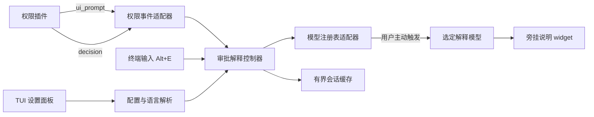

# 02 · 架构与事件流

## 1. 总体架构

本项目是 Pi 进程内的一个独立 TypeScript 扩展，不创建新的 agent loop。



权限插件仍然独占审批决策；图中不存在从解释控制器向权限引擎返回 allow / deny 的路径。

## 2. 为什么选此接入方式

- `permissions:ui_prompt` 标记实际轮到用户处理的提示，而不是排队请求刚产生的时刻。
- `permissions:decision` 与提示通过 `requestId` 关联，可以及时取消解释、清理说明。
- 两类广播都属于观察面；不要求权限插件等待异步解释。
- 原始终端输入监听早于聚焦组件处理输入，因此审批自定义组件打开时仍可识别组合键。
- widget 与原审批 editor slot 分离，能展示说明而不替换审批组件。

不采用 `authorizerChain`，因为本项目不需要前置裁决或额外审批步骤。该接口属于权限插件，而不是 Pi 主程序。

## 3. 模块职责

| 模块 | 职责 | 不应做的事 |
| --- | --- | --- |
| `index.ts` | 注册生命周期、命令、输入监听并组装依赖 | 包含业务流程和提示词大段逻辑 |
| `config.ts` | 校验、读取和原子保存本扩展配置 | 修改 Pi 默认模型或权限规则 |
| `permissions.ts` | 防御性读取公开广播，生成内部请求快照 | 猜测缺失字段、访问私有 prompter |
| `controller.ts` | 请求状态、去重、取消和过期结果保护 | 持有 TUI 布局细节或手工处理认证 |
| `models.ts` | 枚举、定位模型和构建独立模型调用 | 临时切换主会话模型 |
| `prompt.ts` | 构建短解释请求、语言约束和数据边界 | 执行命令或自动读取脚本 |
| `locale.ts` | 本地语言解析与可选公开偏好桥 | 调用 LLM 检测语言 |
| `redaction.ts` | 发送前有限脱敏，声明脱敏边界 | 宣称已识别所有秘密 |
| `cache.ts` | 有界、短期、会话内缓存 | 把原命令和解释持久化到磁盘 |
| `ui/*` | 设置面板、模型选择器、说明 widget | 对业务状态作第二套推导 |

源码布局见 [开发与代码规范](08-development.md)。

## 4. 内部数据契约

以下是设计契约，不是已实现代码。

```typescript
type ModelPreference =
  | { kind: "current" }
  | { kind: "fixed"; provider: string; modelId: string };

type CommandScope = "visible-command" | "visible-unit" | "insufficient";

type ExplanationPhase =
  | "ready"
  | "loading"
  | "done"
  | "failed"
  | "unsupported";

interface PromptSnapshot {
  readonly requestId: string;
  readonly sessionGeneration: number;
  readonly toolName: string | null;
  readonly gateSurface: string | null;
  readonly visibleCommand: string | null;
  readonly scope: CommandScope;
  readonly forwarded: boolean;
  readonly matchedPattern: string | null;
  readonly decidingPath: string | null;
}
```

关键规则：

- 外部广播首先是 `unknown`，验证后才创建快照。
- `requestId` 是权限请求标识，不等于工具调用标识。
- 一次工具调用可能产生多个权限请求，不能把它们合并成一个布尔状态。
- 模型、语言、预算和提示词版本在真正发起请求时快照化。
- 用 `requestId + sessionGeneration + attemptId` 防止旧结果写入新审批。

## 5. 命令与上下文投影

### 5.1 不应只读 `request.value`

顶层 `event.surface` 是显示工具；`event.request.surface` 是实际触发的权限面，两者可能不同。

对于 bash 路径审批：

- `event.value` 可能是命令全文；
- `event.request.value` 可能只是被保护的路径；
- 只能在已可靠确认 shell 语义后，把前者当作命令。

对于 bash 外部路径审批（`bash_external_directory`），`event.value` 与 `event.request.value` 都是命令全文，两者相等并不说明显示值退化成了路径：

- 只有当 `request.decidingPath` 缺失，或它正好等于 `request.value` 时，等值才证明这是路径投影；
- 该形态下门控事实改用 `decidingPath`，不把命令全文再当作门控值重复发送。

对于普通 bash 命令审批，公开显示值可能只有被拦的命令单元；“full command” 可能仅存在于事件未广播的 evidence 中。

因此适配器必须保留解释范围，提示模型和用户：**当前说明基于可见审批内容，不保证覆盖整条命令链。** 不得仅凭命令形状声称拿到了全文。

### 5.2 工作目录

- 直接请求可提供“主会话目录”作为参考事实，但不能把它等同于字面 `cd` 后的目录或别名工具覆盖的 workdir。
- 转发请求没有子会话工作目录时，明确标记未知，不填父会话目录冒充。
- 对未知 shell、环境变量值、别名、函数、脚本内容和文件状态不作确定性推断。
- 不通过命令文本相等来关联并发工具事件，也不读取权限审计日志补上下文。

## 6. 请求状态流

```text
没有待审批
  └─ ui_prompt → ready / unsupported
       ├─ Alt+E + 缓存命中 → done
       ├─ Alt+E + 请求中 → 保持 loading，不重复调用
       └─ Alt+E + 可解释 → loading
            ├─ 成功且仍为同一有效请求 → done
            ├─ 失败或超时 → failed
            └─ decision / reload / session replacement → 取消并清理
```

失败状态下可由用户再次按键显式重试，不自动重试、换模型或转翻译服务。

### 并发与提示队列

- 以 requestId 保存当前可见请求，不使用全局“正在 ask”计数器代替身份。
- 非当前请求的 decision 不得清除当前说明。
- 正常情况下权限插件串行显示审批；出现重叠或版本行为偏差时，以最新已展示事件为当前目标，取消旧显示任务。
- 不试图绕过权限插件自己的队列。

## 7. 独立模型调用

1. 用户触发后读取配置快照。
2. 解析固定模型，或者读取当时 `ctx.model`。
3. 解析目标语言，校验预算及输入大小。
4. 对待发送文本作有限脱敏，构建无工具的短上下文。
5. 通过 `ctx.modelRegistry.streamSimple(model, context, options)` 发起请求。
6. 使用 Pi 既有 provider 与认证，不自行读取或复制密钥。
7. 在 widget 中流式显示文本；完成后有界缓存。

如果选择的是 Pi 虚拟模型，`streamSimple` 可能执行用户配置的路由。该路由与扩展自己的失败回退是两回事，不能承诺实际 provider 与虚拟模型名称相同。首版应标记路由语义，并禁用其跨审批缓存；同一次审批的重复按键仍去重和复用结果。

禁止调用 `pi.setModel()`、`pi.sendUserMessage()` 或创建新的 agent session 来完成解释。直接模型调用是否进入 Pi 原生费用统计不能假定；可在本扩展说明区展示返回的 usage，不为了计费统计把解释塞入主对话。

## 8. 取消与资源管理

- 模型请求使用专属 `AbortController`。
- 组合本次解释超时、会话取消和权限决策信号。
- `abort()` 不能保证供应商不再计费；已生成或服务端继续处理的部分仍可能产生费用。
- 取消后的迟到流事件只丢弃，不更新 UI、不写缓存。
- 所有 timer 在请求结束时清除；退出 / 重载移除输入监听、事件订阅、widget 和缓存。
- 工厂初始化不启动计时器、进程或 watcher。

## 9. 不改变原审批超时

原审批如果配置 `promptTimeoutMs`，扩展不能通过公开事件暂停该时钟。

解释组合键被原始输入监听消费时，未必触发原审批组件“用户已按键”的内部逻辑。因此不能承诺按了解释键就自动停止审批超时。

首版保持原语义：审批超时则结束解释，原审批如何裁决由权限插件决定。不伪造按键、不改内部时钟；如需暂停，必须另行获得公开接口支持。

## 10. 模式与错误隔离

- 仅 `ctx.mode === "tui"` 时注册可交互行为；其他模式不作终端假设。
- 权限插件缺失或事件形状不兼容时，禁用本次解释并给出简短原因，不放宽权限。
- 原始输入处理保持同步、快速，所有异步任务显式捕获错误。
- 广播、解析、翻译字典和 UI 错误都只影响解释扩展，不向原审批写入裁决。
